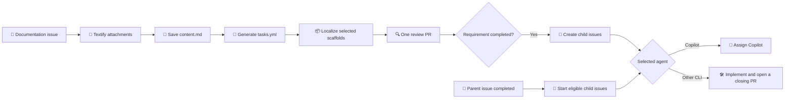

# Web full-stack scaffold

A TypeScript development scaffold for full-stack Web applications. The repository combines reusable server, browser, and mobile starters with GitHub Actions for testing, deployment, requirement intake, and AI-assisted implementation.

## 🧭 Repository architecture

| Path                 | Purpose                                                 |
| -------------------- | ------------------------------------------------------- |
| `server/`            | Node.js REST API scaffold                               |
| `browser/`           | Next.js web application scaffold                        |
| `mobile/`            | Taro mobile application scaffold                        |
| `.github/workflows/` | CI, deployment, submodule updates, and issue automation |
| `script/`            | Shared TypeScript automation used by workflows          |
| `documents/`         | Requirement Markdown and its generated `tasks.yml`      |

The three application folders start as Git submodules. Requirement automation converts selected submodules to ordinary files in a review pull request, so feature work can evolve the relevant scaffold locally.



### Requirement and issue lifecycle

1. A new or reopened `documentation` issue selects one or more scopes and an AI agent.
2. One workflow job converts attachments to Markdown, stores `documents/{issue-title}-{issue-number}/content.md`, analyzes the requirement, and stores ordered tasks in the adjacent `tasks.yml`.
3. The same job initializes and localizes selected scaffold submodules, removes their nested pnpm lockfiles, runs `pnpm -r i --no-frozen-lockfile` from the repository root, and opens one review PR containing the documents and code changes. Workspace installs allow the root lockfile to change because unlocalized submodules may be absent.
4. Closing the documentation issue as completed creates each task as a child issue, labels it with the selected scope and agent, and records the child number in `tasks.yml`.
5. A new or reopened non-documentation issue is delegated to Copilot or the selected coding CLI when its non-documentation parent is completed, or when it has no parent. An open documentation parent does not block delegation, but any parent closed without completion does. Completing an issue starts its eligible open children.
6. Non-Copilot implementations are proposed in pull requests whose descriptions close the corresponding issues.

The issue-creation workflow listens both for issues closed as completed and for changes to `documents/**/tasks.yml`. It checks that each requirement is completed in either case, so requirements closed as not planned or duplicate are skipped, regardless of whether the review PR merges before or after closure.

Configure the provider secret for each non-Copilot agent used by the issue form:

| Agent        | Repository secret             | Description                                                             |
| ------------ | ----------------------------- | ----------------------------------------------------------------------- |
| Claude Code  | `ANTHROPIC_API_KEY`           |                                                                         |
| Gemini CLI   | `GEMINI_API_KEY`              |                                                                         |
| OpenAI Codex | `OPENAI_API_KEY`              |                                                                         |
| Kimi CLI     | `MOONSHOT_API_KEY`            |                                                                         |
| Kilo CLI     | `KILO_CONFIG_CONTENT`         | JSON config with model and provider credentials; see [Kilo CLI docs][6] |
| Qoder CLI    | `QODER_PERSONAL_ACCESS_TOKEN` |                                                                         |

Copilot CLI uses the workflow token unless `COPILOT_GITHUB_TOKEN` is configured; this token is used only by Copilot CLI. GitHub CLI commands use the CI `GITHUB_TOKEN`. For an organization-owned repository, the organization must enable **Allow use of Copilot CLI billed to the organization**. A configured `COPILOT_GITHUB_TOKEN` must be a fine-grained personal access token with the **Copilot Requests** account permission.

## 🧪 Development and tests

Use Node.js 22+ and PNPM 11+:

```shell
pnpm install
pnpm test
```

GitHub Actions jobs that run pnpm allow dependency install scripts automatically, including scripts added by future transitive dependencies. Local installations continue to use the `allowBuilds` approvals in `pnpm-workspace.yaml`.

Automated pull request commits skip Git hooks; local Git hooks remain enabled.

The test suite uses the [Node.js test runner][1], [Jest expect][2], [Jest mock][3], and [Playwright][4]. Chromium is installed by the test lifecycle. Browser tests expect the browser scaffold to be running at `http://localhost:3000`.

Root-level deployment workflows watch the corresponding scaffold directories. The server and browser container deploys use Docker Buildx and SCP/SSH actions, browser previews use the Vercel action, and mobile builds can upload to WeChat.

For container deployment, configure `HOST`, `USER`, and `SSH_KEY`. Set `SSH_HOST_FINGERPRINT` to verify the server's SSH host key; without it, the SSH actions do not verify the host key. Server runtime configuration uses `APP_SECRET`; browser runtime configuration uses `ENV_FILE`. Without `HOST`, the workflows build images but skip remote deployment.

After deployment, all stopped containers and unused images on the host are pruned, including those from other projects.

## 📚 Further reading

1. [Project guide][5]

[1]: https://nodejs.org/api/test.html
[2]: https://jestjs.io/docs/expect
[3]: https://jestjs.io/docs/mock-function-api
[4]: https://playwright.dev/
[5]: https://idea2app.feishu.cn/docs/doccnlKWBaT81RyNXAsHDIWFwph
[6]: https://kilo.ai/docs/code-with-ai/platforms/cli
