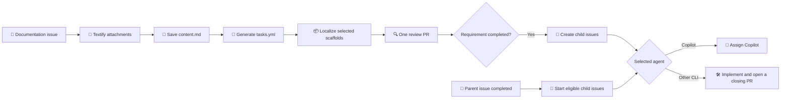

# Web full-stack scaffold

A TypeScript development scaffold for full-stack Web applications. The repository combines reusable server, browser, and mobile starters with GitHub Actions for testing, deployment, requirement intake, and AI-assisted implementation.

## 🧭 Repository architecture

| Path                 | Purpose                                                 |
| -------------------- | ------------------------------------------------------- |
| `server/`            | Node.js REST API scaffold                               |
| `browser/`           | Next.js web application scaffold                        |
| `mobile/`            | Taro mobile application scaffold                        |
| `.github/workflows/` | CI, deployment, submodule updates, and issue automation |
| `script/`            | Shared TypeScript automation used by workflows          |
| `documents/`         | Requirement Markdown and its generated `tasks.yml`      |

The three application folders start as Git submodules. Requirement automation converts selected submodules to ordinary files in a review pull request, so feature work can evolve the relevant scaffold locally.



### Requirement and issue lifecycle

1. A new or reopened `documentation` issue selects one or more scopes and an AI agent.
2. One workflow job converts attachments to Markdown, stores `documents/{issue-title}-{issue-number}/content.md` with issue metadata and the requirement form's Markdown body, and streams end-to-end user-story tasks into the adjacent `tasks.yml`. Task descriptions cover the applicable backend, browser, mobile, and AI skill work.
3. The same job initializes and localizes selected scaffold submodules, removes their nested pnpm lockfiles and root hidden directories, runs `pnpm -r i --no-frozen-lockfile` from the repository root, and opens one review PR containing the documents and code changes. A complete plan closes the requirement when merged; an incomplete plan is preserved for review and must be completed and set to `pending` before closing. Workspace installs allow the root lockfile to change because unlocalized submodules may be absent.
4. Closing the documentation issue as completed creates each task as a child issue, labels it with the selected scope and agent, records the child number in `tasks.yml`, and links prerequisite tasks using GitHub's `blocked by` relationships. `dependsOn` holds an array of earlier task indices; older single-index and null values remain supported.
5. A new or reopened non-documentation issue is delegated to Copilot or the selected coding CLI only when all blocking issues are completed. The parent-child relationship organizes tasks under the documentation issue and does not itself block delegation. Completing an issue rechecks the open issues it blocks.
6. Non-Copilot implementations are proposed in pull requests referencing the corresponding issues.
   The issue-creation workflow listens both for issues closed as completed and for changes to `documents/**/tasks.yml`. It checks that each requirement is completed in either case, so requirements closed as not planned or duplicate are skipped, regardless of whether the review PR merges before or after closure.

### GitHub tokens

The workflows use three tokens for different purposes. Store PATs as repository Actions secrets; do not create a secret for the automatically generated `GITHUB_TOKEN`. Update existing PAT secrets to the names below in [Repository Actions secrets][1].

#### `GITHUB_TOKEN`

- **Application:** Automatically issued for each Actions run. Used by workflow steps and as a fallback by `gh` and Copilot CLI when their higher-priority token variables are unset.
- **Permissions:** No PAT scopes. Grant only the permissions needed in each workflow's `permissions:` block:
    - Issue and PR automation: `issues: write`, `contents: write`, and `pull-requests: write`.
    - Copilot requests: `copilot-requests: write`.
- **Manual settings:** In [Repository Actions settings][2], choose **Read and write permissions** if required. Enable **Allow GitHub Actions to create and approve pull requests** when a workflow creates PRs with this token. No token secret is needed.
- **Organization policy:** For organization-billed Copilot CLI requests, an organization owner must enable the Copilot CLI policy. See [Copilot CLI in Actions][3].

#### `GH_TOKEN`

- **Application:** Classic PAT exposed through the official `gh` environment variable. It takes precedence over `GITHUB_TOKEN` and is used for issue operations and events that must trigger automation.
- **Permissions:** For current workflow usage, select the classic scopes:
    - `repo`: repository read/write access.
    - `workflow`: dispatch workflows.
    - `project`: Project read/write access, if managing Projects; use `read:project` for read-only access.

    Classic scopes are broad and do not provide per-repository read/write controls.

- **Manual setup:** [Create a classic PAT][4], then save it as the [`GH_TOKEN` repository secret][1].

#### `COPILOT_GITHUB_TOKEN`

- **Application:** Fine-grained PAT exposed through Copilot CLI's official Copilot-specific environment variable. It takes precedence over `GH_TOKEN` and `GITHUB_TOKEN` for Copilot CLI authentication; when unset, the CLI falls back to those variables.
- **Permissions:** Create a fine-grained PAT owned by your personal account and grant **Account permissions → Copilot Requests: Read**. This permission authorizes Copilot requests; it is not a repository write permission.
- **Manual setup:** [Create a Copilot fine-grained PAT][5], then save it as the [`COPILOT_GITHUB_TOKEN` repository secret][1].

For organization-owned repositories, the organization must allow Copilot CLI usage billed to the organization. The fine-grained PAT is optional when Actions `GITHUB_TOKEN` is enabled for Copilot requests. See [Copilot CLI authentication][6] and [fine-grained PAT setup][7].

### AI API keys

Configure the provider secret for each non-Copilot agent used by the issue form:

| Agent        | Repository secret             | Description                                                             |
| ------------ | ----------------------------- | ----------------------------------------------------------------------- |
| OpenAI Codex | `OPENAI_API_KEY`              |                                                                         |
| Gemini CLI   | `GEMINI_API_KEY`              |                                                                         |
| Claude Code  | `ANTHROPIC_API_KEY`           |                                                                         |
| Qoder CLI    | `QODER_PERSONAL_ACCESS_TOKEN` |                                                                         |
| Kimi CLI     | `MOONSHOT_API_KEY`            |                                                                         |
| Kilo CLI     | `KILO_CONFIG_CONTENT`         | JSON config with model and provider credentials; see [Kilo CLI docs][8] |

## 🧪 Development and tests

Use Node.js 22+ and PNPM 11+:

```shell
pnpm install
pnpm test
```

GitHub Actions jobs that run pnpm allow dependency install scripts automatically, including scripts added by future transitive dependencies. Local installations continue to use the `allowBuilds` approvals in `pnpm-workspace.yaml`.

Automated pull request commits skip Git hooks; local Git hooks remain enabled.

The test suite uses the [Node.js test runner][9], [Jest expect][10], [Jest mock][11], and [Playwright][12]. Chromium is installed by the test lifecycle. Browser tests expect the browser scaffold to be running at `http://localhost:3000`.

Root-level deployment workflows watch the corresponding scaffold directories. The server and browser container deploys use Docker Buildx and SCP/SSH actions, browser previews use the Vercel action, and mobile builds can upload to WeChat.

For container deployment, configure `HOST`, `USER`, and `SSH_KEY`. Set `SSH_HOST_FINGERPRINT` to verify the server's SSH host key; without it, the SSH actions do not verify the host key. Server runtime configuration uses `APP_SECRET`; browser runtime configuration uses `ENV_FILE`. Without `HOST`, the workflows build images but skip remote deployment.

After deployment, all stopped containers and unused images on the host are pruned, including those from other projects.

## 📚 Further reading

1. [Project guide][13]

[1]: https://github.com/idea2app/Web-full-stack/settings/secrets/actions
[2]: https://github.com/idea2app/Web-full-stack/settings/actions
[3]: https://docs.github.com/en/copilot/how-tos/copilot-cli/use-copilot-cli-in-actions
[4]: https://github.com/settings/tokens/new
[5]: https://github.com/settings/personal-access-tokens/new?name=Copilot+requests+token&user_copilot_requests=read
[6]: https://docs.github.com/en/copilot/how-tos/copilot-cli/set-up-copilot-cli/authenticate-copilot-cli
[7]: https://docs.github.com/en/authentication/keeping-your-account-and-data-secure/managing-your-personal-access-tokens
[8]: https://kilo.ai/docs/code-with-ai/platforms/cli
[9]: https://nodejs.org/api/test.html
[10]: https://jestjs.io/docs/expect
[11]: https://jestjs.io/docs/mock-function-api
[12]: https://playwright.dev/
[13]: https://idea2app.feishu.cn/docs/doccnlKWBaT81RyNXAsHDIWFwph
