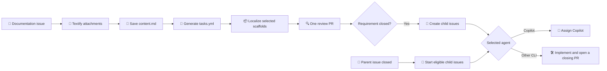

# Web full-stack scaffold

A TypeScript development scaffold for full-stack Web applications. The repository combines reusable server, browser, and mobile starters with GitHub Actions for testing, deployment, requirement intake, and AI-assisted implementation.

## 🧭 Repository architecture

| Path                 | Purpose                                                 |
| -------------------- | ------------------------------------------------------- |
| `server/`            | Node.js REST API scaffold                               |
| `browser/`           | Next.js web application scaffold                        |
| `mobile/`            | Taro mobile application scaffold                        |
| `.github/workflows/` | CI, deployment, submodule updates, and issue automation |
| `script/`            | Shared TypeScript automation used by workflows          |
| `documents/`         | Requirement Markdown and its generated `tasks.yml`      |

The three application folders start as Git submodules. Requirement automation converts selected submodules to ordinary files in a review pull request, so feature work can evolve the relevant scaffold locally.



### Requirement and issue lifecycle

1. A `documentation` issue selects one or more scopes and an AI agent.
2. One workflow job converts attachments to Markdown, stores `documents/{issue-title}-{issue-number}/content.md`, analyzes the requirement, and stores ordered tasks in the adjacent `tasks.yml`.
3. The same job localizes selected scaffold submodules and opens one review PR containing the documents and code changes.
4. Closing the documentation issue creates each task as a child issue, labels it with the selected scope and agent, and records the child number in `tasks.yml`.
5. A non-documentation issue with no open non-documentation parent is delegated to Copilot or the selected coding CLI. Closing an issue starts its eligible open children.
6. Non-Copilot implementations are proposed in pull requests whose descriptions close the corresponding issues.

The issue-creation workflow listens both for closed issues and for changes to `documents/**/tasks.yml`. That covers either order of events: a requirement may close before its review PR is merged, or after the task file reaches the default branch.

Configure the provider secret for each non-Copilot agent used by the issue form:

| Agent        | Repository secret   |
| ------------ | ------------------- |
| Claude Code  | `ANTHROPIC_API_KEY` |
| Gemini CLI   | `GEMINI_API_KEY`    |
| OpenAI Codex | `OPENAI_API_KEY`    |
| Kimi CLI     | `MOONSHOT_API_KEY`  |

Copilot uses the workflow token unless `COPILOT_GITHUB_TOKEN` is configured.

## 🧪 Development and tests

Use Node.js 26 and pnpm 12:

```shell
pnpm install
pnpm test
```

The test suite uses the [Node.js test runner][1], [Jest expect][2], [Jest mock][3], and [Playwright][4]. Chromium is installed by the test lifecycle. Browser tests expect the browser scaffold to be running at `http://localhost:3000`.

Deployment workflows build and deploy their matching scaffold folder; the weekly submodule workflow proposes upstream starter updates for review.

## 📚 Further reading

[Project guide][5]

[1]: https://nodejs.org/api/test.html
[2]: https://jestjs.io/docs/expect
[3]: https://jestjs.io/docs/mock-function-api
[4]: https://playwright.dev/
[5]: https://idea2app.feishu.cn/docs/doccnlKWBaT81RyNXAsHDIWFwph
